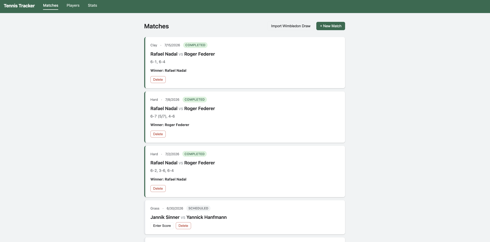
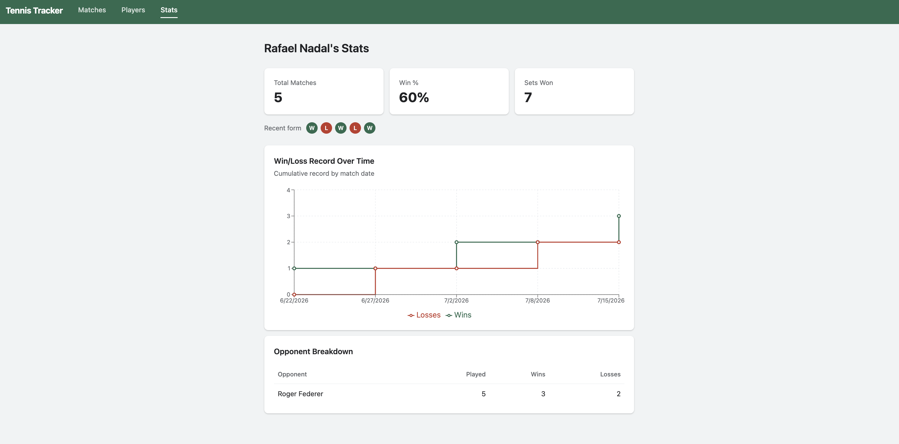

# Tennis Tracker

A tennis match tracker that captures the story behind each match, not just the score.

## Why I built it

I play tennis and take lessons, and building insights for clinical labs at work made me want the same kind of insight into my own game. I started with Wimbledon draw data so the app had real matchups from day one.

## Tech stack

- C# and .NET 8: `TennisTracker.Core`, `TennisTracker.Api`, and `TennisTracker.Data`
- SQLite
- React and Vite
- Recharts

## Features

- Log matches and scores
- Import first-round Wimbledon matchups
- View a stats dashboard with stat cards, a win/loss chart, and an opponent breakdown



## Getting started

### Prerequisites

- .NET SDK 8.0.412
- Node.js 18 or Node.js 20+

### Run the API

From the repository root:

```bash
cd TennisTracker.Api
ASPNETCORE_URLS=http://localhost:5010 dotnet run
```

The API initializes its SQLite database on startup. The checked-in database includes five completed matches for Rafael Nadal, the dashboard's tracked player, so it has sample data to show. Making the tracked player configurable is listed under next steps.

### Run the client

In a second terminal, from the repository root:

```bash
cd client
npm ci
npm run dev
```

Open [http://localhost:3000](http://localhost:3000). Vite forwards `/api` requests to `http://localhost:5010`.

## Dashboard



## Known issues and next steps

- A match can be marked completed without a winner.
- Importing the Wimbledon draw more than once can create duplicate matches.
- Manually entered and imported match start times use inconsistent timezone handling.
- The tracked player is hardcoded. Add a current-player setting so stats can follow the selected player.
